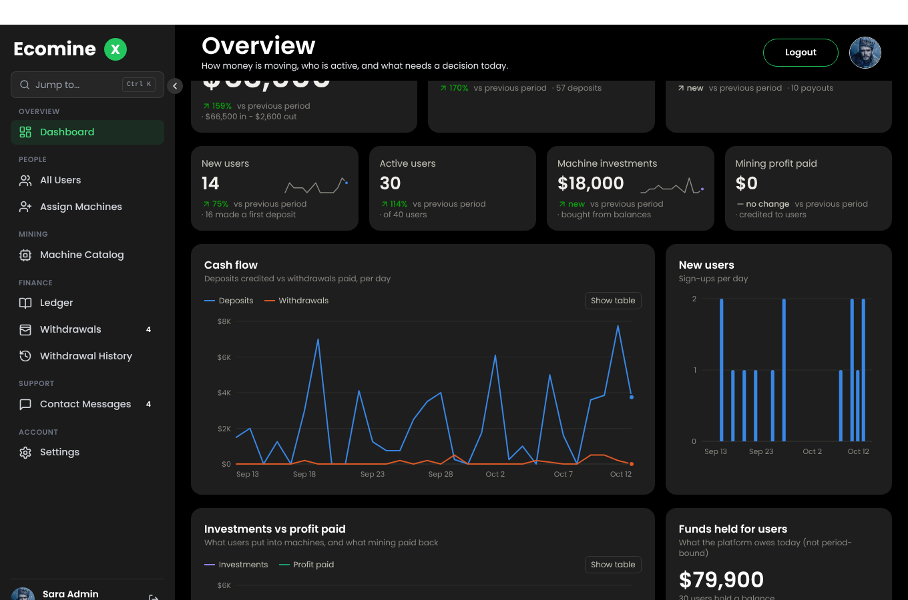
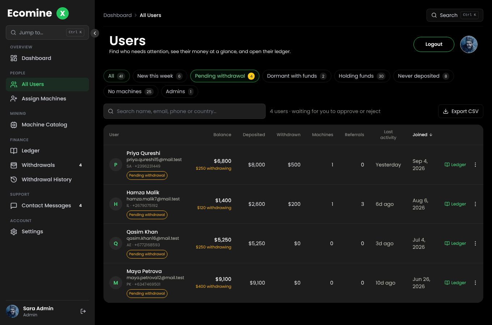
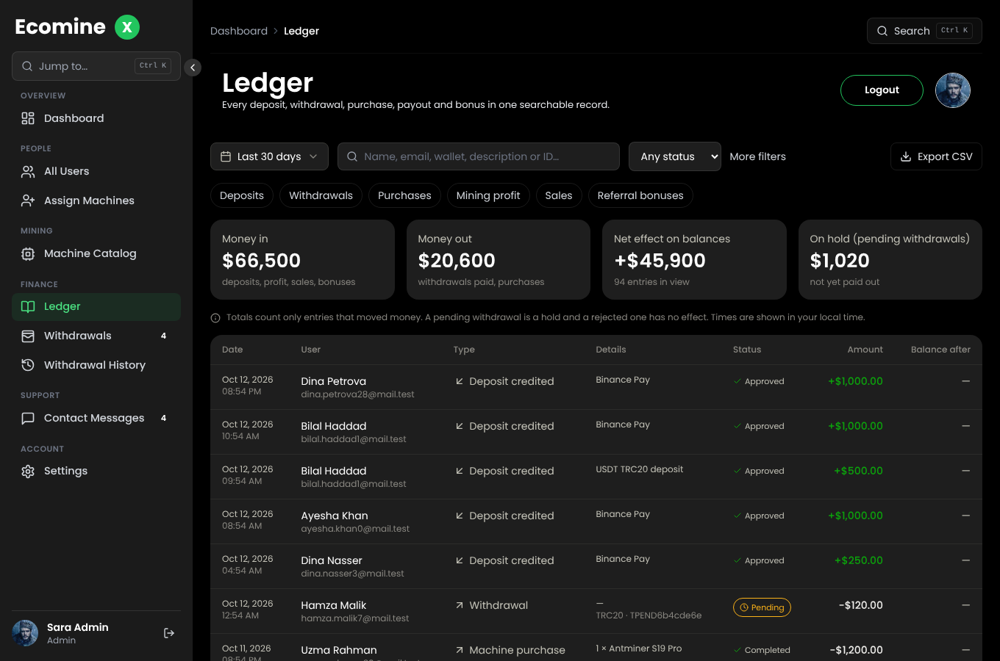

# Ecominex — Next.js + Supabase

Full-stack port of the original *Express + MongoDB* backend and *Next.js* frontend into **one Next.js app on Supabase**
(Postgres, Auth, Storage, Row Level Security). The UI and the URL contract of the API (`/api/v1/*`) are unchanged, so the
existing screens work as before — the data layer underneath is new.

```
Browser ──► Next.js pages (src/app)
        └─► Next.js API routes /api/v1/*  (src/server/handlers)  ──► Supabase Postgres (service role)
                                                                  ├─► Supabase Auth (credentials)
                                                                  └─► Supabase Storage (images)
```

## Setup

1. **Create a Supabase project**, then in the SQL editor paste and run **`supabase/setup.sql`** once. It is the three
   migrations plus the seed in the right order. (Running `seed.sql` alone fails with *relation "mining_machines" does not
   exist* because the tables come from the migrations.) Or use `supabase db push` with the Supabase CLI.
2. **Auth settings** (Authentication → Providers → Email): keep *Confirm email* **on**; you can turn off Supabase's own emails —
   this app sends its own OTP and reset emails (see *Email* below).
3. `cp .env.example .env.local` and fill it in (Supabase URL, publishable key and secret key, `APP_URL`, `APP_JWT_SECRET`, `CRON_SECRET`, email).
4. `npm ci && npm run dev`.
5. **First admin:** sign up in the app, verify the email, then in the SQL editor:
   `update public.profiles set role = 'admin' where email = 'you@example.com';`

### Deploy (Vercel)
Set the same environment variables in the project settings and deploy. `vercel.json` schedules the daily profit job;
Vercel Cron automatically sends `Authorization: Bearer $CRON_SECRET`. (cron-job.org also works: send header `x-cron-secret`.)

## What changed from the old stack
| Old | New |
|---|---|
| Express routes + controllers | Next.js route handlers (`src/app/api/v1/**/route.ts` → `src/server/handlers/*`) |
| MongoDB + Mongoose transactions | Postgres; every money operation is a single SQL function (`supabase/migrations/0002_functions.sql`) with row locks |
| bcrypt + own JWT | Supabase Auth stores/verifies passwords; the API issues 1-day session tokens (`APP_JWT_SECRET`) |
| Cloudinary | Supabase Storage (`machine-images` public, `deposit-proofs` private) |
| `User.mainBalance` + `Balance` (two systems) | One `balances` table (`admin_add` = deposited funds, `mining_balance` = profits) |
| node-cron + cron-job.org | Vercel Cron (or any caller) → `/api/v1/cron/profit-update` |

Removed because the UI never used them: the legacy `/withdrawals/create`, `/withdrawals/show`, `/withdrawal/:id` flow.

## Security model
* The browser never talks to Postgres. All reads/writes go through the API, which authorises each request, then uses the
  **service role** key (server-only). RLS is still enabled everywhere as defence in depth: clients using the anon key can
  only read the public machine catalogue; authenticated clients can only read their own rows; nobody can write.
* Money functions are `SECURITY DEFINER`, executable **only** by `service_role`, and enforce: no negative balances (CHECK),
  purchases paid from deposited funds only, pending withdrawals reserved, withdrawals processable once, deposit callbacks
  credited once, share cap enforced under a row lock.
* Codes and reset tokens are stored hashed; OTPs are limited to 5 attempts; responses never reveal whether an email exists.
* Machine/deposit uploads are validated (image types, 5 MB).

## Admin dashboard
| Page | What it answers |
|---|---|
| **Overview** (`/Dashboard`) | *What needs a decision today?* Pending withdrawals (with age, flagged overdue after 72h), unread messages, dormant users holding funds. Then money in vs out for the chosen period with change vs the previous period, cash-flow / investments / sign-up charts, funds held for users, largest balances and the latest ledger entries. |
| **Users** (`/Dashboard/AllUser`) | Segments with live counts (new this week, pending withdrawal, dormant with funds, never deposited, no machines…), sortable money columns (balance, deposited, withdrawn, machines, referrals, last activity), search, paging, CSV export, per-user ledger link, add balance. Deleting a user who has money or history requires typing their email. |
| **Ledger** (`/Dashboard/Ledger`) | Every money movement in one record: filter by period, type, status, user, amount or text; totals for the filtered set (in / out / net / on hold); CSV export of *all* matching entries. `?user=<id>` filters to one person. |

Shortcuts: `Ctrl/Cmd + K` jumps to any page or user. Filters live in the URL, so any view can be bookmarked or shared.

How the numbers are defined (so they can be audited): *Deposits credited* = approved admin credits and confirmed NOWPayments;
*Withdrawals paid* = approved withdrawals on the **payout date**; a pending withdrawal is a *hold* and a rejected one has no effect;
*Funds held* = sum of all balances (what the platform owes users); days are UTC. All of it comes from one SQL view (`v_ledger`) and four
read-only functions (`supabase/migrations/0004_analytics_and_ledger.sql`), exposed only through `/api/v1/admin/*` to admins.

> Upgrading an existing project: run `supabase/migrations/0004_analytics_and_ledger.sql` once in the SQL editor
> (it is safe to re-run). Referral bonuses now also write a `REFERRAL_BONUS` ledger entry.





## Tests
```bash
npm test            # 57 tests: money logic, RLS, ledger/analytics SQL, migration, CSV and chart maths. No Supabase needed.
npm run typecheck
npm run build && npm run test:e2e   # 40 browser checks: real pages + API + SQL against a fake Supabase (needs Playwright's Chromium)
```
`tests/e2e/serve.mjs` serves the app with demo data (about 40 users, 100 days of activity) for manual exploring.

## Migrating existing MongoDB data
Run this **on your own computer** (never on Vercel). Put `MONGO_URI` only in your local `.env.local`, next to the Supabase variables.
```bash
npm i --no-save mongodb
node --env-file=.env.local scripts/migrate-from-mongo.mjs            # 1) DRY RUN: reads + validates, writes nothing
node --env-file=.env.local scripts/migrate-from-mongo.mjs --commit   # 2) writes to Supabase
```
* Safe to re-run: every row gets a deterministic uuid from its Mongo `_id` and is upserted.
* Users get a random password (bcrypt hashes can't be imported) and sign in via **Forgot password**.
* Copied: users, balances, machines, user machines, shares, transactions, deposits, contacts.
  Old `User.mainBalance` is added to deposited funds (`admin_add`). Duplicate balance documents keep the most recent.
  Negative balances are clamped to 0 (the new schema forbids them).
* It writes `migration-report.json` and **`migration-discrepancies.csv`**: every user whose balance was changed or whose old
  `totalBalance` didn't match `adminAdd + miningBalance` (the old app could lose referral bonuses). Review it before going live.
* Skipped (and counted in the report): records whose user no longer exists, users without a unique email, transactions with unknown types.
* Pending withdrawals stay pending and reserve funds; process them in the admin panel. The legacy `withdrawals` collection is not migrated.
* Typical go-live: dry run -> review CSV -> `--commit` on a quiet moment -> switch DNS. Old deposits/transactions created
  in MongoDB *after* the run are not copied, so re-run `--commit` right before cutover (it only adds/updates).

## Email
`MAIL_EMAIL`/`MAIL_PASSWORD` (Gmail app password) or any SMTP server (`SMTP_*`). Used for signup OTP, 2FA login codes,
password reset, machine assignment and withdrawal notifications.

## Known limitations
* API handlers are verified by build + typecheck and by the SQL tests, but have **not** been exercised against a live
  Supabase project in CI — run through signup, login, deposit, purchase and withdrawal once on a staging project.
* Login tokens still live in `localStorage` (as before). A same-origin cookie session is now possible and recommended as a follow-up.
* In-memory rate limiting is per server instance; use an external store (e.g. Upstash) for strict limits.
